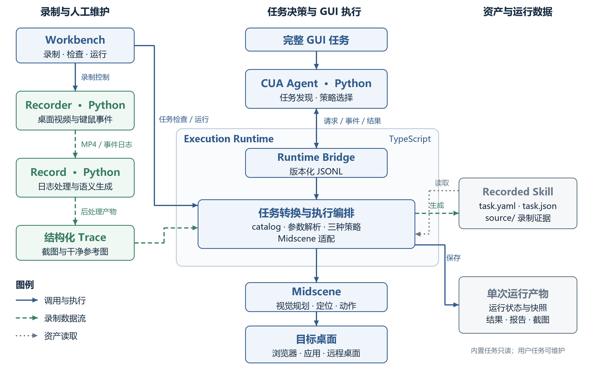
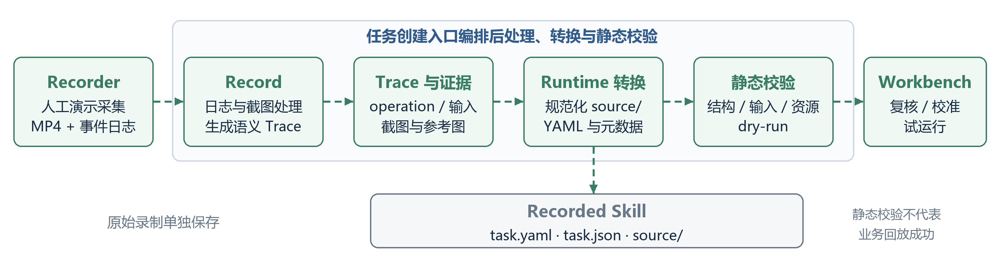
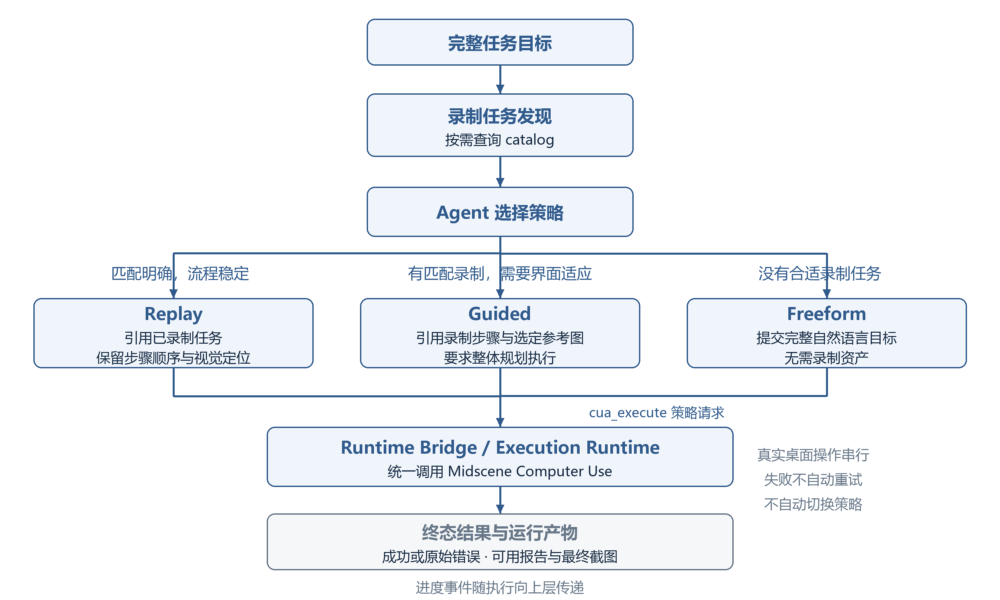
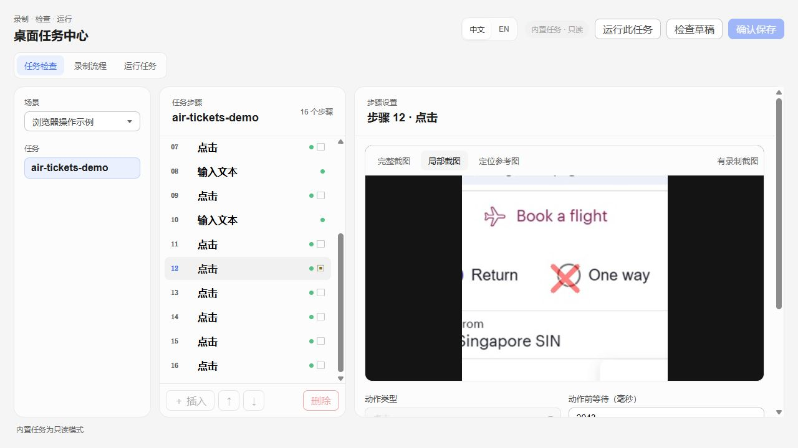
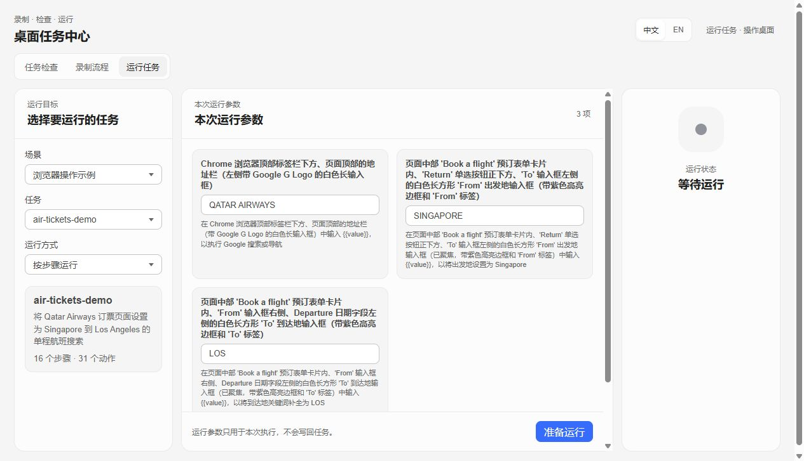

# CUA 总体架构设计

**设计对象：** Computer Use Agent（CUA）

**文档类型：** 总体架构设计（HLD）

## 1 概述

### 1.1 建设背景

企业软件操作可能跨越浏览器、桌面应用、堡垒机和远程桌面。不同环境提供的自动化接口与界面结构并不一致，重复操作也需要沉淀为可维护的流程。

CUA 面向真实桌面，以屏幕视觉理解与键盘鼠标操作为交互基础，并将人工演示转换为可复用的录制任务。系统由任务级 Agent 决策、录制知识处理和 GUI 执行三个部分协作完成任务。

### 1.2 设计目标

1. **跨应用操作：** 通过屏幕与键鼠操作完成完整 GUI 目标，适用于浏览器、桌面应用及远程桌面等场景。
2. **操作知识沉淀：** 将人工演示转换为可维护、可参数化调用的 Recorded Skill。
3. **多种执行策略：** 根据录制任务的匹配程度，选择逐步执行、录制指导执行或自然语言执行。
4. **独立运行与复核：** 提供任务调用、运行产物管理和本地工作台，便于执行、维护与问题定位。

### 1.3 设计范围

本文覆盖 CUA Agent、操作录制、录制解析、任务资产、Execution Runtime、Runtime Bridge 和 Workbench。外部系统集成、接口字段、函数级实现及详细时序由相应的专项文档描述。

## 2 总体技术架构

CUA 采用任务决策、录制知识处理与 GUI 执行分离的模块化架构。Python 承担 Agent、Recorder 和 Record；TypeScript 承担任务转换与管理、执行编排、Midscene 适配及 Workbench 服务。

*图 1 CUA 总体技术架构。蓝色实线表示调用与执行，绿色虚线表示录制数据流，灰色点线表示资产读取。任务管理与 Runtime Bridge 均属于 TypeScript Execution Runtime。*

### 2.1 模块职责

| 模块 | 主要职责 | 实现边界 |
| --- | --- | --- |
| CUA Agent | 接收完整目标、发现录制任务、选择策略并调用私有工具 | Python `agent/`；不自行进行截图级动作规划 |
| Recorder | 采集桌面视频与物理键鼠事件 | Python `recorder/`；Windows 录制进程 |
| Record | 处理日志、提取截图并生成结构化 Trace | Python `record/`；基于 ShowUI-Aloha Learn 的录制后处理 |
| 任务管理 | 转换 Trace、组织任务资产、发现任务并解析输入 | TypeScript `execution/cua/`；属于 Execution Runtime |
| Execution Runtime | 实现执行策略、编排运行、调用 Midscene 并保存产物 | TypeScript `execution/`；GUI 执行由 Midscene 完成 |
| Runtime Bridge | 传递 Agent 请求、进度事件和终态结果 | `execution/runtime-bridge/`；版本化 JSONL 跨进程边界 |
| Workbench | 提供录制、任务检查、维护、运行及结果入口 | `execution/review/`；本地网页与服务 |

### 2.2 调用与依赖关系

Agent 的执行路径为 **Python Agent → TypeScript Runtime Bridge → Execution Runtime → Midscene → 目标桌面**。Runtime worker 在自身进程中直接调用 Midscene API，执行路径不包含额外任务 runner。

Workbench 的常规录制、任务维护与运行功能直接调用 Runtime 服务；仅 `review --dev` 提供 Python Agent 调试入口。两种入口复用任务契约与执行实现，Workbench 不承担 Agent 策略决策。

## 3 核心功能架构

### 3.1 GUI 录制与语义轨迹生成

Recorder 采集人工演示的视频和键鼠事件；Record 处理事件日志、提取关键截图，并调用视觉模型生成结构化 Trace。Trace 以操作类型、目标描述与输入内容表达操作意图，供任务转换使用。

点击类证据包括完整截图、带点击标记的局部图和无标记的参考图。带标记局部图用于理解演示中的点击位置，干净参考图用于执行时的视觉定位，两者用途不同。

### 3.2 Recorded Skill 生成与管理

Recorded Skill 是以场景和任务组织的可复用录制任务资产包。Runtime 根据 Trace 的结构化 `operation` 确定性生成 Midscene 原生 YAML，不从其他自然语言字段猜测动作。

- `task.yaml`：唯一长期执行事实源，保存有序操作流程及参数占位符。
- `task.json`：保存任务元数据、输入定义、录制默认值及来源绑定。
- `source/`：保存 Trace、处理日志、截图及视觉参考证据。

任务位于外部数据目录，发布包不附带内置任务。单次输入在解析后进入独立运行快照，不写回任务。复核和校准通过 Workbench 或维护入口完成；Agent 的私有工具不提供任务创建或长期编辑能力。

### 3.3 Agent 任务决策

CUA Agent 每次接收一项完整 GUI 任务，在一次调用内执行模型 Tool Calling。内部工具包括：

- `cua_catalog`：发现场景、任务及其输入要求。
- `cua_execute`：按明确选定的策略执行完整目标。
- `cua_workbench`：在需要录制、复核、校准或调试时打开工作台。

Agent 负责选择任务和执行策略，具体视觉观察、元素定位及键鼠动作交由 Midscene。Agent 不保存跨调用会话、长期记忆或用户聊天历史；调用方需要提供本次任务所需的目标、输入与约束。

### 3.4 GUI 执行引擎

| 策略 | 实现机制 | 适用场景 |
| --- | --- | --- |
| Replay | 按顺序执行解析后的 Midscene YAML；交互步骤使用视觉定位 | 匹配明确、流程稳定的录制任务 |
| Guided | 将解析后的录制步骤及选定参考图投影为整体指导，由 Midscene 统一执行 | 有匹配录制知识、需要对当前界面进行适应 |
| Freeform | 将完整自然语言目标直接交给 Midscene 原生 `aiAct()` | 无匹配录制任务或临时性任务 |

三种策略共用 Midscene Computer Use。Replay 保留流程顺序；Guided 使用录制知识提供执行指导；Freeform 不依赖录制任务或预生成 YAML。策略由 Agent 在执行前明确选择，失败后不自动切换或重试。

### 3.5 Workbench 可视化工作台

Workbench 提供任务检查、录制流程和运行任务三个常规入口。用户可查看录制证据、维护本地任务、设置本次输入并访问可用的执行报告。保存任务前进行契约校验与 revision 冲突检查；空项目可从录制创建场景和任务。

## 4 核心业务流程

### 4.1 录制与 Skill 生成

人工演示产生视频与事件日志，经 Record 处理为 Trace 与截图证据，再由 Runtime 转换为任务资产并进行静态校验。Workbench 提供后续复核、校准与试运行入口。

*图 2 录制与 Recorded Skill 生成流程。任务创建入口统一编排后处理、资产规范化、转换与静态校验。*

转换后的 `source/` 保存规范化证据，不复制原始视频和事件日志。步骤顺序与来源绑定用于支持复核；需要视觉参考的步骤绑定已有干净参考图，缺失或无效时明确失败。静态校验检查任务结构、输入与资源引用，业务流程是否可达仍需实际运行验证。

### 4.2 GUI 任务执行

Agent 在任务可能已有录制知识时查询 catalog，依据匹配结果选择 Replay、Guided 或 Freeform。没有匹配任务本身不构成信息不足；只有缺少必要业务目标、输入或约束时，才请求补充。

*图 3 任务决策与执行流程。三条策略分支进入同一 Runtime 与 Midscene 执行体系，最终返回状态和可用产物。*

执行过程中，Runtime 向 Agent 传递关联的进度事件。执行结束后返回成功状态或原始错误，以及可用的报告、最终截图等产物信息，供调用方消费。Agent 不以创建任务、修改流程或静默重试掩盖执行失败。

## 5 数据与运行架构

### 5.1 数据资产组织

长期资产与单次运行数据分别管理：

| 资产 | 存储位置 | 用途 |
| --- | --- | --- |
| 用户任务 | `<CUA_DATA_ROOT>/projects/<scene>/<task>/` | 创建、复核和长期维护 |
| 运行数据 | `<CUA_DATA_ROOT>/runs/<run-id>/` | 本次快照、状态、结果、截图及 Midscene 报告 |
| 原始录制 | `CUA_RECORDINGS_ROOT` 指定的目录 | 保存视频与事件日志，作为录制处理输入 |

录制任务执行保存 `resolved-task.yaml`；Freeform 保存本次自然语言 prompt 与结果，不要求任务 YAML。参考图的长期路径保持任务内相对路径，仅在运行快照中解析为绝对路径。

运行历史按空间策略清理，活动运行与保护窗口内的记录受到保护；任务和原始录制不参与该清理。报告与截图需要长期保留时应单独归档。

### 5.2 运行时通信

Python Agent 与 TypeScript Runtime 通过版本化 JSONL 协议传递请求、进度事件与终态结果。一次 Agent 调用可复用一个 Node worker，调用结束后释放；不同调用不共享 Agent 消息或 worker 状态。

Runtime Bridge 负责协议与执行分发，不承载模型决策。Workbench 的本地服务负责网页与用户操作入口；跨语言 bridge 不等同于外部系统接入服务。

### 5.3 部署方式

组件包含三个 Python wheel、编译后的 TypeScript Runtime、JavaScript 生产依赖、任务资源、schemas 和 manifest。组件不携带 Python 或 Node.js 可执行程序，也不携带真实环境配置与用户数据。

部署环境提供兼容运行时、模型配置，并在安装阶段准备 Python 第三方依赖。构建、安装和依赖解析均不在每次任务执行时进行。

## 6 关键技术设计与架构约束

### 6.1 视觉交互与流程复用

GUI 执行以屏幕与键鼠为基础，不以 DOM、浏览器驱动或 CDP 为执行底座。录制任务保存可读的语义操作与选定参考图，而非固定坐标回放脚本。整体能力取决于模型视觉与规划能力、目标界面及运行环境。

### 6.2 职责与事实源

Agent 负责任务级决策，Record 负责演示语义生成，Runtime 负责转换、解析与执行，Midscene 负责具体 GUI 操作。`task.yaml` 保持唯一长期执行事实源，录制证据与单次执行产物各有独立用途。

### 6.3 能力边界

- 真实桌面操作必须串行；Runtime 不提供跨进程全局操作锁，调用方负责协调。
- Recorder 面向 Windows，记录物理键鼠事件，不还原中文输入法最终提交文本。
- 录制任务表达已演示的有序路径，不具备完整的业务条件分支与异常恢复知识体系。
- Guided 可依据录制步骤进行视觉适应，不保证跨版本自动修复。
- 执行失败明确终止并保留可用诊断，不自动切换策略、重试或修改任务；Skill 自愈不属于现有能力。

## 7 总结

CUA 以录制和语义轨迹生成沉淀操作知识，以任务资产保存可复用流程，以 Agent 选择执行策略，并通过统一的 Runtime 与 Midscene 完成桌面操作。工作台和运行产物为任务维护、执行复核与问题定位提供支撑。

实现说明见 [CUA Agent](../agent/README.md)、[Execution Runtime](../execution/README.md)、[Recorder](../recorder/README.md)、[Record](../record/README.md) 与[组件交付](component-distribution.md)。

## 附录 工作台运行界面

*图 4 Workbench 任务检查界面。步骤列表与带点击标记的录制局部图用于复核操作证据。*

*图 5 Workbench 运行任务界面。本次输入与运行方式独立于长期任务资产；截图显示等待运行状态。*
